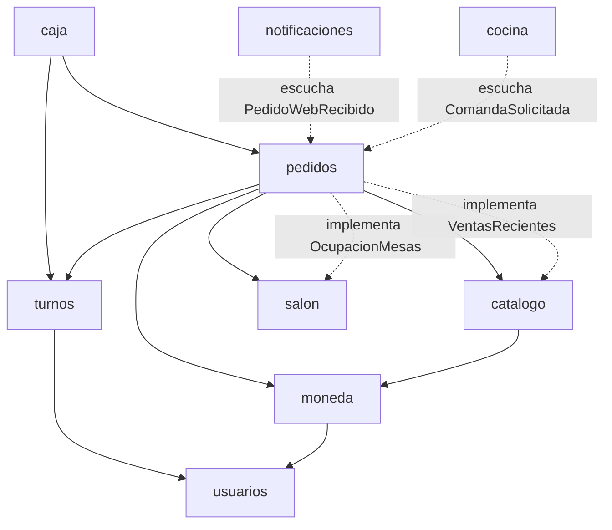

# Arquitectura: monolito modular

El backend es **una sola aplicación** (un solo `ocumare.jar`, una sola base de datos), organizada por
**módulos de negocio**. Cada módulo tiene sus propias capas (`controller`, `service`, `repository`,
`model`, `dto`). Spring Modulith revisa que los módulos no se crucen (`ModulosTest`).

## Módulos

Todos viven en `src/main/java/com/project/ocumare_food/`.

| Módulo | Qué hace | API pública (lo que otros módulos pueden usar) |
|---|---|---|
| `compartido` | Errores de negocio, dinero, reloj, configuración web | Todo (módulo abierto) |
| `usuarios` | Login, sesión (cookie + JWT), usuarios y roles, seguridad | `Usuarios`, `UsuarioActual`, `model` (Usuario, Rol) |
| `moneda` | Tasa de cambio manual y automática del BCV | `TasaService`, `model` (TasaCambio, Moneda) |
| `catalogo` | Categorías, productos, fotos, menú público y carrusel | `CatalogoService`, `VentasRecientes`, `model` (Producto…) |
| `salon` | Mesas: zonas, orden, renumerar | `MesaService`, `OcupacionMesas`, `model` (Mesa) |
| `turnos` | Abrir turno, turno actual | `TurnoService`, `model` (Turno…), `dto` (TurnoResponse) |
| `pedidos` | Pedidos del POS y de la web, pagos | `ConsultasPedidos`, `ResumenVentas`, `PedidoWebRecibido`, `model` |
| `caja` | Cierre de turno, conteo de caja, dashboard | (nadie lo usa) |
| `cocina` | Comandas de cocina, impresoras, rutas para CloudPRNT y el puente | (nadie lo usa) |
| `notificaciones` | Aviso a Telegram de pedidos web | (nadie lo usa) |

**La API pública de un módulo** es lo que está en su paquete raíz (por ejemplo `pedidos/ConsultasPedidos.java`)
más los paquetes marcados con `@NamedInterface` en su `package-info.java` (por ejemplo `pedidos/model`).
Todo lo demás (`repository`, `service`, `controller`, `dto`) es interno del módulo.

## Dependencias (sin ciclos)

Todos usan `compartido` y `usuarios` (`UsuarioActual`). Casos especiales:

- **salon no depende de pedidos.** Para saber si una mesa está ocupada, salon define la interfaz
  `OcupacionMesas` y pedidos la implementa (`OcupacionMesasPedidos`). Así no hay ciclo.
- **caja no lee tablas de pedidos.** Pide los totales a `ConsultasPedidos` (pedidos por estado,
  venta por mesero, recaudo por método, mesero y día).
- **notificaciones reacciona a un evento.** Pedidos publica `PedidoWebRecibido` y notificaciones avisa
  a Telegram después de guardar. Pedidos no sabe que Telegram existe.
- **cocina reacciona a un evento.** Pedidos publica `ComandaSolicitada` cuando un pedido entra a cocina,
  se le agregan o quitan platos, se anula o se reimprime. Cocina guarda la comanda en la misma
  transacción y la impresora la viene a buscar. Pedidos no sabe que hay impresoras.
- **El carrusel de la web lo arma catalogo** con los platos impulsados por el gerente y, después, los más
  vendidos de 30 días. Catalogo no conoce los pedidos: define `VentasRecientes` y pedidos la implementa
  (`MasVendidos`), igual que `OcupacionMesas`. El resultado se guarda 5 minutos.
- **La bitácora vive en pedidos** (`EventoPedido`): cada acción sobre un pedido deja una línea con quién
  la hizo. Lo delicado (quitar platos ya enviados a cocina, anular, reimprimir) queda marcado como alerta.

## Reglas para no degradar la estructura

1. Un módulo **nunca** usa el `repository` de otro. Si necesita un dato, lo pide a la API pública del dueño.
2. Si dos módulos se necesitan mutuamente, uno de los dos define una interfaz o un evento (como `OcupacionMesas`).
3. Correr las pruebas (`probar.bat`). `ModulosTest` falla si alguien rompe una regla, y deja los diagramas
   en `build/spring-modulith-docs/` (PlantUML).

## Cómo agregar un módulo nuevo

1. Crear el paquete `com.project.ocumare_food.<modulo>` con sus subpaquetes.
2. Poner en la raíz del paquete solo lo que otros deben usar (un `XxxService` y, si aplica, eventos).
3. Si otros módulos deben referenciar sus entidades, agregar `package-info.java` con `@NamedInterface("model")`.
4. Para reaccionar a lo que pasa en otro módulo, preferir eventos (`@TransactionalEventListener`)
   sobre llamadas directas.

## Qué NO cambió en el refactor

- Las **rutas de la API** son las mismas (`/api/mesas`, `/api/menu`, `/api/turnos/cerrar`…), así que el POS y la web no cambian.
- Las **tablas** son las mismas: no hay migración en Aiven.
- La lógica de negocio es la misma. Las 74 pruebas originales siguen pasando, más 2 nuevas en `ModulosTest`.
  Único detalle: los datos de prueba (solo perfil dev) quedaron divididos en `DatosDePruebaSalon` y
  `DatosDePruebaUsuarios`. Ahora los usuarios de ejemplo se crean aunque ya existan mesas.

## Siguiente paso: la plantilla (proyecto aparte)

> El módulo de **inventario** (insumos, recetas, descuento al enviar a cocina, agotado automático) ya está
> hecho y probado en la rama `modulo-inventario`. No va en Ocumare Food Hot; queda para la plantilla.

OFH conserva su marca y sus módulos básicos. La plantilla (`pos-restaurante-base`) se copia de este
punto y ahí se hacen las fases que faltan:

- **Fase 3:** más comunicación por eventos (p. ej. `PedidoPagado`, `TurnoCerrado`).
- **Fase 4:** módulos opcionales con propiedades (`modulos.salon.activo`, `modulos.moneda.activo`,
  `modulos.notificaciones.activo`) y renombrar `ocumare.*` a un prefijo genérico.
- **Fase 5:** la marca (nombre, logo, colores) pasa a configuración.

Módulos que se podrían agregar a la plantilla para un software más especializado:

| Módulo | Para qué | Se conecta con |
|---|---|---|
| `cocina` (KDS) | Pantalla de cocina con los pedidos en preparación | escucha eventos de pedidos |
| `inventario` | Insumos, recetas por producto, descuento automático, alertas de stock bajo (**hecho**, rama `modulo-inventario`) | escucha `ComandaSolicitada` |
| `compras` | Proveedores, órdenes de compra, costo de insumos | inventario |
| `clientes` | Historial y datos de clientes frecuentes, fidelización por puntos | pedidos (teléfono) |
| `delivery` | Repartidores, zonas y tarifas, estado del envío | pedidos tipo DELIVERY/WEB |
| `reservas` | Reservar mesas por fecha y hora | salon |
| `promociones` | Combos, descuentos por horario, cupones | catalogo, pedidos |
| `facturacion` | Factura fiscal según el país (SENIAT, DIAN…) | escucha `PedidoPagado` |
| `sucursales` | Varios locales con un mismo sistema | transversal (es el cambio más grande) |
