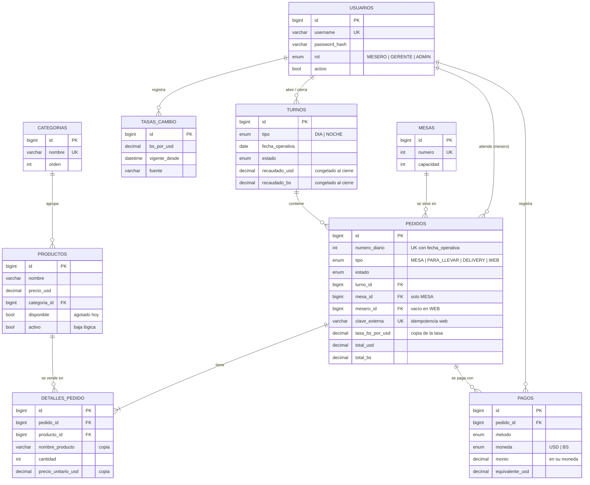

# Ocumare Food — Modelo entidad-relación (Paso 1)

## Reglas de diseño

1. **Dinero con `BigDecimal`, nunca `double`.** Montos con 2 decimales, tasa con 4 (`util/Dinero`).
2. **El precio base está en USD.** El monto en Bs se calcula con la tasa y queda guardado en el pedido (`tasa_bs_por_usd`); si la tasa cambia, los pedidos viejos no se alteran.
3. **Los detalles copian nombre y precio.** Cambiar el menú afecta solo a pedidos futuros.
4. **Pago mixto.** Un pedido tiene N pagos; cada uno en su moneda real. El corte suma `$` y `Bs` por separado (lo que hay en caja) y el `equivalente_usd` dice si el pedido ya quedó saldado.
5. **Turno día/noche** con `fecha_operativa`: la noche que cruza la medianoche cuenta para el día en que empezó. Un turno por tipo por día.
6. **Baja lógica** en usuarios y productos, para no romper el historial.
7. **Pedidos web**: tipo `WEB`, sin mesero, con `clave_externa` única para que un reintento no duplique.
